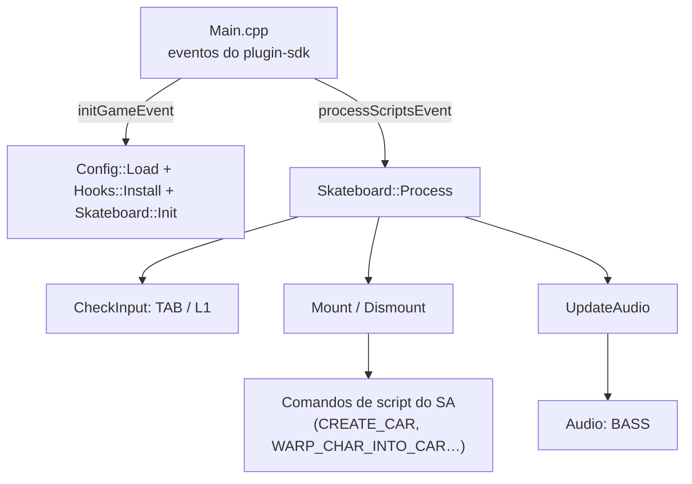

<div align="center">

# SkateMod+

*Plugin ASI para GTA San Andreas que porta o Skate Mod original (script CLEO) e o prepara para animações e tricks no estilo Tony Hawk's American Wasteland.*

</div>

<p align="center">
  
  
  
</p>

| | |
| --- | --- |
| **Versão** | 0.1 (sem tag) |
| **Estado** | Port funcional do mod original: monta, anda e guarda o skate. Animações e tricks do THAW ainda não começaram. |
| **Contexto** | Projeto pessoal de modding |
| **Alvo** | GTA San Andreas 1.0 US (build `PLUGIN_SGV_10US`), Windows 32 bits |

> **Limite principal:** só foi testado no jogo do autor, com ModLoader, fastman92 Limit Adjuster, Urbanize e SAAWR instalados. Não há testes automatizados. O pulo e os tricks continuam sendo os da bike nativa do jogo.

## Sumário

- [Início rápido](#início-rápido)
- [1. Objetivo](#1-objetivo)
- [2. Arquitetura](#2-arquitetura)
- [3. Estrutura do repositório](#3-estrutura-do-repositório)
- [4. Configuração e compatibilidade](#4-configuração-e-compatibilidade)
- [5. Build e instalação](#5-build-e-instalação)
- [6. Critérios de aceite](#6-critérios-de-aceite)
- [7. Escopo e evolução](#7-escopo-e-evolução)
- [8. Documentação complementar](#8-documentação-complementar)
- [9. Autores e licença](#9-autores-e-licença)

## Início rápido

1. Baixe o zip da [última release](https://github.com/josemurilors/SkateModPlus/releases/latest). Ele já traz o `SkateMod+.asi`, os modelos, a animação, o áudio e o `skateboard.ini`.
2. Copie o conteúdo para a pasta do jogo e siga o `LEIA-ME.txt` do pacote (fastman92, prioridade no ModLoader e escolha do `VehicleID`).
3. No jogo, pegue a cane (pickup) e aperte **TAB**.

Para compilar do código-fonte, veja a [seção 5](#5-build-e-instalação).

## 1. Objetivo

Substituir o script CLEO `skateboard.cs` por um plugin ASI, mantendo o mesmo comportamento e o mesmo `cleo/skateboard.ini`, para depois evoluir o skate (animações, tricks, grinds, manuals) sem editar nenhum arquivo do Urbanize e convivendo com o SAAWR.

Faz hoje:

- Monta e guarda o skate com a cane equipada (arma `WeaponType`).
- Cria o skate como veículo `bmx` (modelo `sktbd`), com a animação `CHOPPA_sprint`.
- Toca o som de rolagem (`skate.mp3` via BASS), com volume por velocidade e distância.
- Cria os 17 pickups de skate pelo mapa (`ChangePickups`).
- Aplica o *bike arm fix* (patch em `0x6B8202` e `0x6B8559`, os mesmos do `bikearmfix.asi` original).

Não faz: animações ou tricks novos do THAW, física própria, interface.

## 2. Arquitetura



O `Skateboard::Process` roda a cada frame. Fora do skate, detecta o gatilho de montar. No skate, confere se o veículo e o jogador ainda estão ligados, mantém o jogador desarmado e atualiza o áudio. Sair do skate é a saída nativa de veículo, como no original.

### Controles

| Entrada | Fora do skate | No skate |
| --- | --- | --- |
| TAB (teclado) | Monta (com a cane equipada) | Guarda o skate |
| L1 (controle) | Monta | Livre, é da bike |
| Sair do veículo | n/a | Desmonta e devolve a cane |
| Botão de pular | n/a | Bunny hop nativo da bike (a confirmar no jogo) |

### Stack

| Área | Escolha | Papel |
| --- | --- | --- |
| Linguagem | C++20 (MSVC, x86) | Código do plugin |
| Jogo | [plugin-sdk](https://github.com/DK22Pac/plugin-sdk) | Acesso às estruturas e comandos de script do SA |
| Áudio | `bass.dll` do jogo | Som de rolagem, carregado dinamicamente |
| Build | CMake / `cl` | Ver [seção 5](#5-build-e-instalação) |

## 3. Estrutura do repositório

```text
SkateMod+/
├── src/
│   ├── Main.cpp          # registra os eventos do plugin
│   ├── core/
│   │   ├── Skateboard.*  # lógica de montar, guardar, áudio e pickups
│   │   ├── Config.*      # leitura do cleo/skateboard.ini
│   │   └── Audio.*       # som de rolagem (BASS)
│   └── hooks/Hooks.*     # bike arm fix
├── tests/config_test.cpp # teste do leitor de ini (não precisa do jogo)
├── docs/                 # engenharia reversa e planejamento
└── CMakeLists.txt
```

## 4. Configuração e compatibilidade

O plugin lê `cleo/skateboard.ini`, com as mesmas chaves do original:

| Chave | Padrão | Função |
| --- | --- | --- |
| `WeaponType` | 15 | Tipo da arma (cane) que dá o skate. Também é o tipo dos pickups, como no original. |
| `WeaponModel` | 326 | Modelo da arma (`gun_cane`, com a textura do skate) |
| `VehicleID` | 74 | ID do veículo, usado só se o modelo `sktbd` não for achado pelo nome |
| `Volume` | 0.3 | Volume do som, de 0.0 a 1.0 |
| `ChangePickups` | 1 | `1` cria os pickups de skate |

### Escolha do `VehicleID`

O ID 74 do original é um buraco de ped que o mod *Restored Unused Peds* também usa. Com o conflito, o `CREATE_CAR` crasha. O plugin recusa o mount e grava o motivo em `SkateModPlus.log`. Use um ID livre e igual no `skateboard.ini` e na linha do `Vehicles.ide` (`Linhas.txt` do Skate Mod). No setup do autor funciona o **12250**. Ele fica fora das faixas do SAAWR (veículos de 12500 a 19999, armas de 12400 a 12499) e livre nos `.ide` instalados.

O modloader desta instalação não aceitou `-1` como ID automático.

### Prioridade no ModLoader

Outros mods trocam o `gun_cane`, como o NeXtGen Remaster Weapons e o RoSA. Dê ao Skate Mod prioridade maior no `modloader.ini`, ou os pickups voltam com a textura da cane:

```ini
[Profiles.Default.Priority]
skate mod = 90
```

### Urbanize e SAAWR

O `GLNPS.cs` do Urbanize acha o skate com `get_model_by_name "sktbd"` e lê só `WeaponType` e `WeaponModel` do ini. O plugin respeita esse contrato e não altera arquivos do Urbanize. Detalhes em [saawr-compatibility.md](docs/saawr-compatibility.md) e [urbanize-skate-integration.md](docs/urbanize-skate-integration.md).

## 5. Build e instalação

### Pré-requisitos

- Visual Studio 2022 com C++ para desktop (toolset x86).
- [plugin-sdk](https://github.com/DK22Pac/plugin-sdk) compilado, com `Plugin.lib` em `output/lib`.

### Build verificado

O caminho que funciona hoje é a chamada direta ao `cl`, num prompt x86 do Visual Studio (`vcvars32.bat`). Troque `SDK` pelo caminho do plugin-sdk:

```bat
set SDK=E:\projetos\plugin-sdk
cl /c /Foout\ /EHsc /std:c++20 /MT /O2 /W0 /I src /I %SDK% /I %SDK%\shared /I %SDK%\shared\game /I %SDK%\plugin_sa /I %SDK%\plugin_sa\game_sa /I %SDK%\plugin_sa\game_sa\rw /I %SDK%\injector /I %SDK%\plugin_sa\game_sa\enums /D WIN32 /D NDEBUG /D _WINDOWS /D GTASA /D PLUGIN_SGV_10US /D _CRT_SECURE_NO_WARNINGS /D RW src\Main.cpp src\core\Config.cpp src\core\Audio.cpp src\core\Skateboard.cpp src\hooks\Hooks.cpp
link /DLL /OUT:out\SkateMod+.asi /LIBPATH:%SDK%\output\lib out\*.obj Plugin.lib d3d9.lib user32.lib kernel32.lib gdi32.lib shell32.lib advapi32.lib
```

> O `CMakeLists.txt` (C++20, defines e includes iguais ao comando acima, `-A Win32`) foi reescrito, mas **ainda não foi executado**: não havia CMake instalado na máquina do autor. Se falhar, use o comando `cl` acima.

### Instalação

1. Copie `SkateMod+.asi` para a pasta do jogo.
2. Instale o Skate Mod original no ModLoader, mas **remova** o `skateboard.cs` (o plugin o substitui, senão os dois rodam).
3. Siga o `Readme` original do mod: no `fastman92limitAdjuster_GTASA.ini`, ative o patch do `handling.cfg` e aumente as linhas padrão e de bike.
4. Ajuste o `VehicleID` ([seção 4](#4-configuração-e-compatibilidade)).

### Diagnóstico

O plugin grava `SkateModPlus.log` na pasta do jogo com o motivo de o mount falhar (arma errada, no ar, ID em conflito etc.). O comportamento no jogo só se valida jogando.

### Testes

O leitor do `skateboard.ini` tem um teste que roda sem o jogo (usa linhas reais do ini, com comentários `#`):

```bat
cl /EHsc /std:c++20 /I src tests\config_test.cpp src\core\Config.cpp /Fe:config_test.exe user32.lib
config_test.exe
```

Saída esperada: `config_test: ok`.

## 6. Critérios de aceite

- [x] Montar o skate com TAB e a cane equipada
- [x] Guardar o skate com TAB e sair pela saída normal do veículo, sem crash
- [x] Pickups de skate aparecem pelo mapa
- [x] Coexistir com Urbanize e SAAWR sem editar arquivos deles (testado no setup do autor)
- [ ] Pulo no teclado e no controle — depende do bunny hop nativo, ainda sem confirmação
- [ ] Montar no ar como o original permite — hoje o plugin bloqueia
- [ ] Animações e tricks do THAW — não iniciado
- [x] Teste do leitor de ini (`tests/config_test.cpp`)
- [ ] Build por CMake — reescrito, mas não executado

## 7. Escopo e evolução

**Dentro:** port fiel do mod original e integração com Urbanize e SAAWR.
**Fora:** editar arquivos do Urbanize; ser gerenciado pelo SAAWR.
**Evoluções possíveis:** ollie, flips, grinds, manuals e revert, com animações do THAW ([plano](docs/VIABILITY_AND_IMPLEMENTATION_DISCUSSION.md)); ID de veículo automático.

## 8. Documentação complementar

- [Especificação completa do mod original](docs/skatemod_full_specification.md)
- [Plano de implementação](docs/VIABILITY_AND_IMPLEMENTATION_DISCUSSION.md)
- [Compatibilidade com SAAWR](docs/saawr-compatibility.md)
- [Integração com Urbanize](docs/urbanize-skate-integration.md) e [análise do GLNPS](docs/glnps-analysis.md)
- [Engenharia reversa do Skate Mod](docs/skatemod-reverse.md) e [áudio e animações](docs/skatemod-audio-anim.md)
- [Mecânicas e animações do THAW](docs/thaw-mechanics.md)

## 9. Autores e licença

| Nome | Papel | GitHub |
| --- | --- | --- |
| José Murilo R. Sabalo | Autor do port ASI | <!-- TODO: usuário do GitHub --> |

Skate Mod original (MixMods): **Linevariy**, com correções de **Junior_Djjr** e **M. Osborn**; correção ao segurar o skate: **Victor Troquetti**; `bikearmfix.asi`: **Ryosuke839**. Modelos, texturas, animação e áudio da release são desses autores. Detalhes em [CREDITS.md](CREDITS.md).

Licença: <!-- TODO: definir a licença -->
